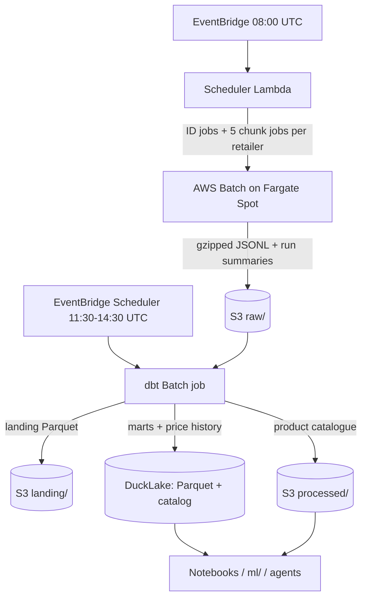

# Irish Supermarket Price Tracker


Scrapes product prices from four Irish supermarkets (**Tesco, Aldi, SuperValu, Dunnes Stores**) every
day, keeps the raw responses in S3, and turns them into a price-history dataset with dbt and DuckDB.

## How it fits together



- **Scraping** (live): per-retailer ID scripts and API scripts share `scraper_common/`, with a
  data-quality gate and a run summary per chunk.
- **Transformation** (rolling out, currently in shadow mode): `dbt/` builds staging, intermediate and mart
  models; the daily price history lives in a DuckLake lakehouse (Parquet on S3 plus a small catalog).
- **Analysis and ML**: `ml/`, `ml_common/` and `notebooks/` read the marts and the product catalogue.

## Start here

- **[docs/infrastructure_guide.md](docs/infrastructure_guide.md)**: the full, beginner-friendly guide
  (architecture, where every dataset is stored, all tests and gates, runbooks, costs).
- [AGENTS.md](AGENTS.md): concise conventions for contributors and coding agents.
- [docs/dbt_orchestration_plan.md](docs/dbt_orchestration_plan.md): design and rollout of the scheduled dbt pipeline.
- [dbt/README.md](dbt/README.md): running dbt locally and the price-history model.

## Quick commands

```bash
uv sync --group test --group dev
uv run --group test pytest
uv run ruff check . --extend-exclude notebooks
```
